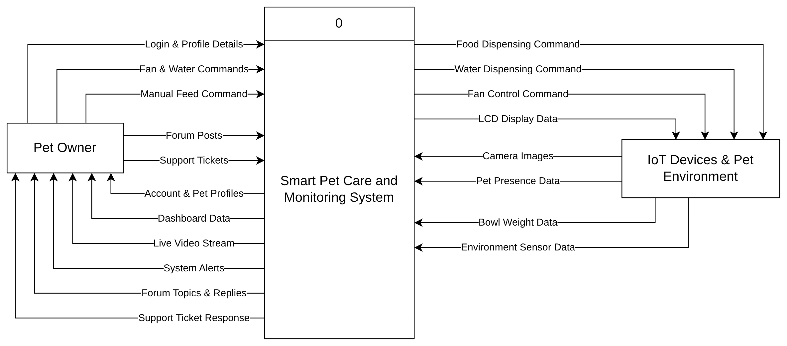

# Smart Pet Care and Monitoring System

My final year project at Universiti Malaysia Sabah (2026). A feeder that recognises which pet is at the bowl, gives that pet its own portion, refills the water and cools the room, while the owner watches and controls everything from a Flutter app.



## Results

- **Pet recognition:** YOLOv11n trained on Roboflow for 10 breed classes reached mAP@50 93.0%, precision 94.4% and recall 92.4% on a 162-image test set
- **Prototype test:** identified the test pet correctly in 10 of 10 trials
- **Portion control:** every tested portion (10 g, 25 g and 50 g on both compartments) was dispensed at 93% accuracy or better

## How it works

```
                    ┌──────────────── Raspberry Pi 3 ────────────────┐
 HC-SR04 #1 ─┐      │ Mosquitto MQTT broker                          │
 HC-SR04 #2 ─┤      │ pi_bridge.py                                   │      Firebase RTDB        Flutter app
 HX711 A/B  ─┤      │   • camera + YOLOv11n (10 classes)             │  ┌──────────────────┐   (web / Android)
 DHT22      ─┼ESP32─┼─MQTT─►  • decides: which pet? which compartment? ├─►│ devices/feeder01 │◄──► Dashboard
 Water lvl  ─┤      │   • forwards telemetry / commands / config     │  │  status, config, │     Feeder control
 Servo A/B/C◄┤      │   • logs feedings, alerts                      │  │  pets, commands, │     Pets & portions
 Relay pump ◄┤      └────────────────────────────────────────────────┘  │  logs, feedings, │     History charts
 Relay fan  ◄┘                                                          │  alerts, history │     Alerts / Forum
                                                                        └──────────────────┘
```

1. An ultrasonic sensor sees a pet at the bowl and the ESP32 publishes a presence event over MQTT.
2. The Raspberry Pi runs the YOLOv11 model on the camera; at least 3 frames must agree before a breed is accepted.
3. The Pi matches the breed to a pet profile, checks the meal rules (meals per day, hours since the last meal) and sends a dispense command.
4. The ESP32 opens that compartment's gate in short pulses and weighs the bowl on a load cell until the portion is reached.
5. The result goes to Firebase and the app. When the pet leaves, the Pi weighs the bowl again to record how much was eaten.

The ESP32 keeps the water refill and cooling fan running even if Wi-Fi or the Pi goes down.

## Tech stack

| Part | Technology |
|---|---|
| Microcontroller | ESP32 (Arduino C++) with HX711 load cells, HC-SR04, DHT22, water level sensor, servos and relays |
| Edge computer | Raspberry Pi 3, Python, Picamera2/OpenCV, YOLOv11 (Roboflow) |
| Messaging | MQTT through a password-protected Mosquitto broker on the Pi |
| Cloud | Firebase Realtime Database, Authentication and security rules |
| App | Flutter (web and Android) |

## Repository layout

| Folder | Contents |
|---|---|
| `firmware/esp32_pet_feeder` | ESP32 firmware: sensors, food gates, water pump, fan, MQTT |
| `firmware/esp32_hardware_test` | Serial-menu test for each component |
| `raspberry_pi` | MQTT-to-Firebase bridge, pet detector, systemd service, Mosquitto config |
| `app` | Flutter dashboard: live status, feeder control, pet profiles, history, alerts |
| `firebase` | Realtime Database and Firestore security rules |
| `docs` | Context diagram and data flow diagrams |

## Running it yourself

Passwords and keys are not in this repository. Before running:

1. **ESP32:** set `WIFI_SSID`, `WIFI_PASS`, `MQTT_USER` and `MQTT_PASS` in `firmware/esp32_pet_feeder/esp32_pet_feeder.ino`.
2. **Raspberry Pi:** set the environment variables `MQTT_USER`, `MQTT_PASS`, `ROBOFLOW_API_KEY`, `ROBOFLOW_MODEL_ID`, `ROBOFLOW_WORKFLOW_URL` and `DATABASE_URL` (see `raspberry_pi/config.py`), put your Firebase service-account key next to the code as `serviceAccountKey.json`, then follow the comments in `mosquitto/petfeeder.conf` and `petfeeder.service`.
3. **App:** run `flutterfire configure` inside `app/` to generate `lib/firebase_options.dart`, and set `rtdbUrl` in `lib/config.dart`.

## Author

Desmond Ong Kye Xiang, Bachelor of Computer Science with Honours (Network Engineering), Universiti Malaysia Sabah
